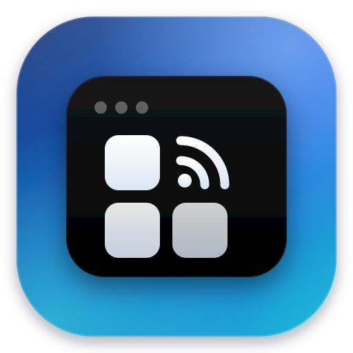
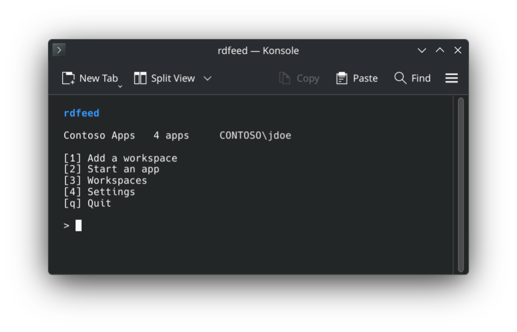
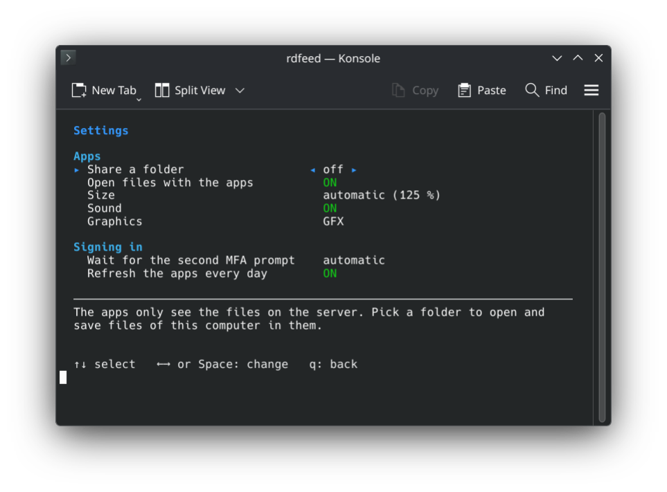

<p align="center">
  
</p>

<h1 align="center">rdfeed</h1>

<h3 align="center">The RemoteApps of your company, in the Linux app menu.</h3>

<p align="center">
  Word, Excel and the other Windows apps your company publishes open as windows of their own.<br>
  Like "Work Resources" on Windows, through FreeRDP.
</p>

<h5 align="center">
  <a href="#install">Install</a> |
  <a href="#how-to-use">How to use</a> |
  <a href="#is-it-safe">Is it safe?</a> |
  <a href="https://github.com/LoonixTools/rdfeed/issues">Report a bug</a>
</h5>

<p align="center">
  <a href="https://ko-fi.com/felitendo"></a>
</p>

<p align="center">
  
</p>

## Install

<details>
<summary><b>Arch</b>, CachyOS, EndeavourOS, Manjaro</summary>

```bash
yay -S rdfeed
```

</details>

<details>
<summary>Other distributions</summary>

See [Build from source](#more). It needs FreeRDP 3, Python 3, bash and
`secret-tool` (libsecret).

</details>

## How to use

```bash
rdfeed
```

Press **1** and type the address your IT department gave you. The server
name or your work e-mail address often works too. Then sign in with your
Windows user name and password.

The apps show up in your app menu, in a folder with the name of the
workspace. Click one and it opens in a window of its own. If your company uses
MFA, confirm the sign-in in your authenticator app. Many servers ask twice: a
notification tells you when the second prompt is coming.

Files on your computer open in the apps too: right-click a `.docx` and pick
**Open with**, then Word.

<details>
<summary>Settings</summary>

<p align="center">
  
</p>

</details>

## Is it safe?

Your password goes into the keyring, not into a file. FreeRDP gets it through
a pipe, so it never shows up in the list of running programs.

The connection files from the server can ask to share every drive, camera and
USB device of your computer. rdfeed removes that. The apps only see the folder
you pick under **Share a folder**, and none by default. When you open a file in
an app, its folder is shared while that app runs.

## More

<details>
<summary>What it fixes in FreeRDP</summary>

Starting a RemoteApp with plain `xfreerdp3` often goes wrong. rdfeed takes care of it:

- **It hangs after the MFA prompt.** A connection broker needs a second sign-in
  at the gateway. Its prompt only comes if the client waits about ten seconds,
  and FreeRDP does not wait. rdfeed does.
- **Y and Z are swapped.** Under Wayland, FreeRDP sees the wrong keyboard layout.
  rdfeed asks the desktop.
- **The apps are blurry or tiny** with a scaled desktop. rdfeed has the server
  draw them at your scale.
- **Signing in to the feed fails.** It needs NTLM, which `curl` no longer
  always has. rdfeed signs in by itself.

</details>

<details>
<summary>Known problems</summary>

- **A window stays partly empty after you minimize or resize it.** This is a
  bug in FreeRDP. Under **Settings**, **Graphics** on classic paints every
  window right, but some servers end the session with it.
- **A second app of the same workspace takes over the first one's connection.**
  Its windows move into the new one, nothing closes.

</details>

<details>
<summary>How it works</summary>

| | |
|---|---|
| `rdfeed` | The menu and the commands. |
| `rdfeed-fetch` | Signs in to the feed and downloads the apps and their icons. |
| `rdfeed-hook.so` | Goes into FreeRDP: the wait for the second MFA prompt, and the classic graphics if you pick them. |
| `rdfeed-refresh.timer` | Loads the apps again once a day, so new ones show up. |

The feed is the one Windows subscribes to under *RemoteApp and Desktop
Connections* (`https://server/RDWeb/Feed/webfeed.aspx`). Azure Virtual Desktop
and Windows 365 sign in another way and are not supported. All details:
`man rdfeed`.

</details>

<details>
<summary>Build from source</summary>

```bash
make
make test
sudo make install
```

Needs a C compiler, and for the translations and the man page gettext and
scdoc. To run it: bash, Python 3, FreeRDP 3 (`xfreerdp3` or `xfreerdp`) and
`secret-tool`.

</details>

## Credits

- [FreeRDP](https://www.freerdp.com/), which does the actual work.
- [MS-NLMP](https://learn.microsoft.com/openspecs/windows_protocols/ms-nlmp/), for NTLM and its test vectors.

GPL-3.0-or-later.
